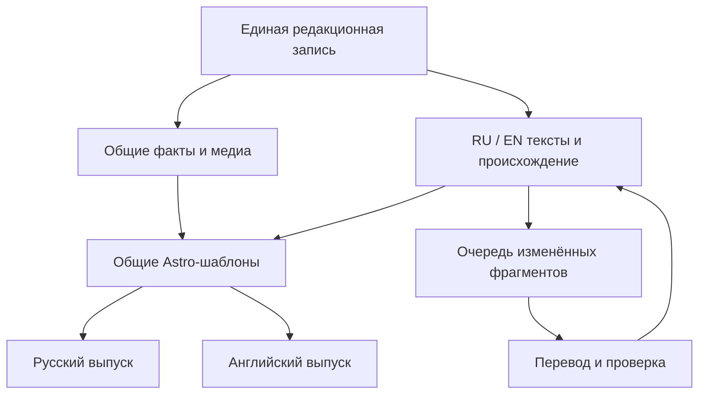

# Ada Tours RU/EN: архитектура одного сайта с двумя языковыми представлениями

Дата: 28 октября 2026. Основание: запрос Алексея и фактический код на
`b1b14ed3a8abab9773053f836fed28c2ff77204f`.
Рабочая ветка: `feat/english-site-foundation`.
Статус: проектное решение и начальное изолированное ядро; массовый перевод,
подключение EN к Astro и публикация нового домена ещё не выполнены.

## 1. Главное решение

Один исходный репозиторий, одна модель туристических продуктов, один набор
компонентов, одна медиатека и два языковых слоя. Русский и английский HTML
собираются из одного commit. Домены задаются конфигурацией, а не записываются
в переводах и не определяют идентичность тура.

Не нужно синхронизировать две самостоятельно редактируемые копии сайта:
редактируется единый продукт. Для цен, состава маршрута, фотографий и кода это
устраняет конкурирующие исходные записи; обе публичные версии совпадут после
подтверждённого общего выпуска. Для свободного текста требуется дополнительный
процесс: изменение одного языка создаёт адресную задачу для второго, сохраняя
редакторские правки и утверждённые Word-фрагменты.

### Реалистичное значение «автоматически»

| Что изменили в любом редакционном интерфейсе | Что происходит в обеих версиях |
| --- | --- |
| Цена, валюта, даты, доступность, included/optional | Меняется одна общая запись; пересчитываются карточки, фильтры, SEO и JSON-LD. Текст с зашитым старым значением отправляется на адресную проверку. |
| Фото, улучшение, mobile hero, фокус, видео | Меняется общий media reference/receipt. Обе сборки используют новый ресурс. Перевод обычного абзаца не запускается; подпись проверяется, если сменился сам изображённый объект. |
| Новая страна, место, тур, экскурсия | Создаётся один ID и общие связи; автоматически появляются необходимые задачи второго языка. Страница нового языка появляется после готовности текста, а не как русский дубль. |
| Архивирование/снятие тура | Общий статус исключает его из каталогов, поиска, счётчиков и предложений обоих языков; исправляются зависимые рекомендации. История и действующие URL сохраняются по правилам архива. |
| Новый фильтр, компонент, исправление кода | Один исходный код включается в оба артефакта; проверяется комплект RU/EN интерфейсных строк. |
| Русский абзац | Меняется fingerprint конкретного блока; EN получает задачу обновления только этого блока. Точный Word-текст и независимая редактура не перезаписываются без проверки. |
| Английский абзац | Та же процедура в обратную сторону. Фактическая поправка проходит в общий слой; стилистическая правка не заставляет механически переписывать русский текст. |
| Сам Word на Drive | Один наблюдатель сверяет revision/hash, строит diff и затрагивает лишь зависимые пары/блоки. Build не обращается к Drive. |

Нельзя обещать одновременно мгновенную публикацию произвольного перевода и
гарантированное сохранение смысла. Предлагаемый контракт: факт распространяется
автоматически, перевод автоматически ставится в очередь и проходит QA. Это
контролируемая задержка, видимая в статусе, а не бесконечно забытая рассинхронизация.

## 2. Что есть сейчас и почему одного переключателя языка недостаточно

Фактические зависимости и точные файлы перечислены в SEO-аудите этого каталога.
Коротко:

- Astro 7.3.4, Node >=24, статическая сборка. `deploy.yml` сейчас публикует
  `SITE_ORIGIN=https://adatours.ru`, `SITE_BASE=/`.
- `src/lib/routes.ts` уже строит английские пути по устойчивым ID; slug не надо
  переводить повторно. Исторические aliases сохраняются.
- Цены, программа, связи, изображения и RU-текст сейчас соседствуют в Markdown
  Content Collections. Схема допускает `locale`, но загрузчики часто жёстко
  отбирают `ru`; полнофункциональной EN-сборки нет.
- Метаданные проходят несколько уровней: шаблон/MD → компоновка title → цены →
  отдельная RU-поправка «русский гид». Перевод только полей в MD не покрывает их.
- В `BaseLayout` SEO/GEO-статьи загружаются только для RU. Поиск, карта, captions,
  social previews, fallback shell и часть валидаторов также содержат RU.
- В текущих массивных блоках нет постоянных `blockId`. Сопоставление по индексу
  перестанет работать при вставке нового дня.
- Есть отдельные внешние соответствия старому `adatours.com`. Они не являются
  ни переводами, ни Word mapping, ни реестром будущих языковых версий.

Новая библиотека локализации поэтому пока не меняет `SITE.locale` и не включена
в production loader. Это предотвращает публикацию русского HTML под EN-доменом.

## 3. Модель данных и безопасная миграция

### 3.1. Общая часть

Едиными остаются: `entityId`, тип, текущий slug, статусы, страна/места/связи,
основной и дополнительный маршрут, длительность, фактический набор услуг,
offers, цены, валюта, даты, вместимость, географические координаты, подтверждённые
внешние идентичности, media asset ID/URL/receipt, crop/focus, видео, порядок блоков.

Для цены обязательны структурные `priceBasis` (`per_person`, `per_group`,
`per_tour`), размещение, вместимость/минимальная группа и другие условия
применения тарифа. Минимумы и сравнения считаются только внутри совместимых
предложений. Текущая проверка одной валюты USD в `seo-price-meta.mjs` этого
ещё не гарантирует; русский `priceNote` нельзя использовать как универсальный
языконезависимый parser.

Общий Tour и его коммерческое предложение — разные уровни. Если английская Word
версия относится к поездке с другим языком гида, минимальным размером группы,
ценой или набором услуг, это отдельный **offer/variant** либо конфликт, требующий
решения; это не стилистический перевод одной строки. Локаль страницы сама по
себе не означает английского гида, USD, британского клиента или новый договор.

### 3.2. Языковая часть

В слое `en` находятся только разрешённые тексты: title/name, lead/summary, body,
заголовки и абзацы дней, впечатления, описания услуг, пояснения к цене, SEO
overrides, SEO/GEO-статьи, FAQ, alt/hover/caption, поисковые aliases и видимые
названия справочных значений. Структурированные цены и факты не дублируются в EN JSON; их текстовые упоминания связаны с общим источником через зависимости и fingerprints.

Каждый блок имеет постоянный `blockId`, семантическое поле, точный текст,
источник, hash исходного текста, зависимости от общих фактов и статус QA.
Например, блок `arrival-rio:transfer-description` остаётся тем же блоком при
переносе его с дня 1 на день 2. Номер дня — представление порядка, не ключ.

Строки маршрута и `itinerary.places` сейчас местами представляют географию
русскими названиями. Их нужно адресно нормализовать в ссылки на существующие
Destination ID; видимое имя берётся из нужного языкового слоя. Неоднозначное
название не создаёт дубликат места. Резервы без опубликованного материала
сохраняют статус резерва и не создают пустые EN-страницы.

### 3.3. Два шага вместо разрушительной миграции всей базы

**Первый шаг:** текущий RU Markdown остаётся совместимым авторитетным источником
общих фактов и русского текста. Адаптер выделяет из него `shared.facts`,
`shared.media` и RU-блоки; EN overlay хранится отдельно. Это не второй набор
цен, а проекция действующей записи. Все существующие импорты Word, фотоочереди,
ежедневный цикл 2027 и content gateway продолжают менять ту же исходную запись.

**Второй шаг, после пилота:** при необходимости выделить нейтральные факты в
`data/entities/<type>/<id>.json`, оставив совместимые адаптеры для текущих скриптов.
Нет причины одновременно переносить тысячи файлов, переписывать URL и запускать
перевод: это усложнит проверку причин ошибок. Выделение нейтрального хранилища
не является условием полезной первой EN-версии; единый writer фактов — является.

Рекомендуемые пути будущего полного процесса:

| Путь | Роль |
| --- | --- |
| `src/content/*/ru/*.md` или фактический текущий contentPath | Текущий совместимый источник RU и общих фактов; пути не переименовывать |
| `data/i18n/block-maps/<entityId>.json` | Устойчивая идентичность сегментов; никаких ID из индекса массива |
| `data/i18n/sources/` | Закреплённые безопасные источники, ревизии, hashes и extract receipts |
| `data/i18n/matches/` | Доказанные Tour ↔ Word соответствия и блоковая карта |
| `src/content-locales/en/<type>/<entityId>.json` | Принятые EN-блоки без общих фактов |
| `data/i18n/queue/v1/` в отдельной staging-ветке | Manifest, shards, результаты, receipts, summary |
| `data/i18n/publications/` | Выпуски RU/EN с исходным SHA и подтверждениями deploy |

Пути выше — контракт следующей реализации, не заявление, что все эти каталоги
уже заполнены. Реально созданные файлы перечислены в итоговом отчёте.

## 4. Изменения в обе стороны без циклов и потери правок

У редакционной операции есть `changeId`, инициатор, `originLocale`, base hashes,
тип изменения (`fact`, `text`, `media`, `code`) и зависимости. Сервис перевода
передаёт `derivedFromChangeId`; его собственный результат не создаёт бесконечный
обратный перевод того же изменения.

Для текста сохраняются три версии: базовая согласованная пара, новая исходная
версия и текущая целевая редакция. Если целевой блок не менялся, исполнитель
готовит адресный вариант. Если менялись оба языка, система создаёт конфликт с
двумя вариантами, а не выбирает последний по времени. Хеш цены не является
хешем абзаца; смена фото не делает весь Tour `stale`.

Редакторская правка `word_exact` выводит изменённый фрагмент из режима точного
Word-копирования: нужна отдельная provenance `editorial` и причина, при этом
исходная Word evidence сохраняется в истории. Нельзя изменить текст и оставить
старую пометку «дословно из Word».

### Когда факт уже изменился, а текст ещё не готов

1. Цена/дата в отдельном структурном поле получает одну общую ревизию. Обе
   публичные версии обновляются после подтверждённого выпуска; до него журнал
   явно показывает отставший deployment.
2. Абзац со старой ценой, датой, включением или обязательным ограничением нельзя
   оставлять рядом с новым предложением. Он блокирует соответствующий offer;
   каталог временно исключает этот offer до исправления либо показывает безопасное
   подтверждённое состояние без противоречивого предложения.
3. Независимое литературное уточнение без изменения фактов может оставить
   предыдущий принятый перевод на время очереди, с внутренним статусом отставания.
4. Незавершённый перевод нового объекта не выдаётся за published; нет RU fallback
   в EN body, sitemap, hreflang или поисковом индексе.

Эти решения должны применяться по конкретному объекту и зависимости, чтобы
один нерешённый тур не останавливал публикацию всех новых фотографий сайта.

## 5. Домены, URL и размещение

Файл `src/data/i18n/sites.json` содержит кандидат EN `https://adatours.com`.
`locale-site.mjs` уже проверяет origin, строит URL из логического пути,
сохраняет media/entity origin и при вызове проверки публикации отклоняет planned
EN. Проверка пока не подключена к действующему build/deploy. Замена
домена требует изменения настройки и повторной сборки, а не перевода контента.

На разных доменах пути одинаковые: условно `/brazil/tour/<existing-slug>/`.
Добавлять `/en/` на отдельном английском домене не требуется. Временный preview
может иметь base path; его нельзя индексировать или добавлять в hreflang. До
выдачи окончательного домена готовим закрытый preview/защищённый staging.
`noindex` — дополнительная защита индексирования, не контроль доступа.

### Выбор способа размещения

Оставить текущий RU GitHub Pages и единственный source repo. У GitHub Pages
максимум один project site на репозиторий [1], поэтому один и тот же Pages
deployment нельзя выдать за два независимых сайта с разным языковым HTML.

Практичный первый вариант: EN получает второй deployment target. Если это
GitHub Pages, отдельный репозиторий хранит **только результат сборки** и
минимальную конфигурацию публикации, а не копию исходников. Исходники, тексты,
цены, скрипты и исправления по-прежнему в `adatours.ru`. Межрепозиторийный доступ
на выдачу артефакта должен быть настроен отдельно с минимальными правами.

Альтернатива при требованиях к закрытому staging, redirects и единому выпуску:
два статических origin/bucket либо один поддерживающий несколько host сервис,
публикуемый тем же pipeline. Миграция RU-хостинга для запуска переводов не нужна.
Выбор конкретного EN target выполняется после проверки предоставленного домена
и возможностей редиректов. Сейчас новые репозитории, DNS, платные сервисы и
production deployment не создаются.

Медиатека единая `img.adatours.ru`: повторная обработка и повторная загрузка
из-за языка запрещены. Международный CDN может быть отдельным измеренным
инфраструктурным улучшением; менять физическое хранилище ради перевода не нужно.

## 6. Один выпуск, два артефакта

1. Зафиксировать immutable source SHA, версию overlay/mapping и конфигурацию доменов.
2. Собрать `dist/ru` и `dist/en` одним общим кодом с явным locale context.
3. Проверить каждый: язык, отсутствие RU fallback в EN, ссылки, canonical,
   метаданные, соответствие JSON-LD видимому контенту, локальные индексы поиска,
   формы, media receipts, размер артефакта.
4. Сохранить hashes артефактов и deploy intent до внешней записи.
5. Опубликовать и подтвердить каждый target по exact SHA/releaseId.
6. `synchronized` присвоить только после обоих подтверждений. Если один target
   не обновился, статус `partially_deployed`, адресный retry/rollback и уведомление.

Два независимых хостинга не дают настоящей общей транзакции. Координатор
ограничивает и отслеживает промежуток расхождения; при строгом требовании к
одновременности нужен общий release pointer/edge routing. Не обещать атомарность,
которой у двух Pages deploy нет.

Переход цены/даты должен иметь приоритетный маршрут обновления. Отставание EN
deploy от RU не остаётся незаметным: публикационный журнал показывает обе версии
SHA, время, причину и текущий retry. Откат берёт готовые предыдущие артефакты,
не переписывает историю Git и не перезаписывает S3-медиа под старым именем.

## 7. SEO, schema.org и старый adatours.com

- Каждая языковая страница имеет собственный canonical на своём host. Canonical
  EN не указывает на RU как на «главный оригинал» [2, 3].
- Взаимные `hreflang=ru/en` строятся только для реально опубликованных эквивалентных
  страниц одного entity ID/состава каталога. Не ссылаться на неготовые страницы
  или произвольную главную вместо отсутствующего перевода.
- `x-default` добавляется только при явном назначении реальной страницы выбора
  языка/default; для первого релиза он не обязателен.
- Одна фактическая Organization имеет устойчивый `@id`. На EN её `sameAs`
  включает `https://adatours.ru/`; существующие подтверждённые профили сохраняются.
- WebSite и WebPage имеют свои URL и `inLanguage`. Для переведённых CreativeWork
  используется `translationOfWork`, обратная связь — `workTranslation` [4].
  Это не замена hreflang. `sameAs` означает идентичность, а не тематическую
  похожесть [5]. Туристические продукты и геообъекты связываются по общим ID;
  отношения перевода не добавляются произвольно к TouristTrip/Place.
  Независимо утверждённая английская программа Word и общий Tour ID сами по себе
  не доказывают происхождение всего EN-текста от RU. Связь перевода добавляется
  лишь на том уровне CreativeWork, где она действительно соответствует источнику.
- Все видимые FAQ, хлебные крошки, Offer descriptions, названия и alt переводятся;
  числа, валюта и подтверждённая доступность остаются фактическими.
- Старый `.com` уже имеет собственные URL. До замены домена получить полный
  инвентарь, сохранить отдельную карту exact old EN URL → new EN URL, проверить
  её против уже существующих external-identity реестров, настроить постоянные
  серверные редиректы и не направлять всё на главную.

Временный EN-домен мигрирует отдельным выпуском: новый origin → проверка HTTPS,
canonical/hreflang/sitemaps/OG/search/form allowlist → перенаправления со старого
host → проверка ключевых URL. Контент и ID при этом не меняются.

## 8. Заявки, поиск и операционная поддержка

Наблюдатель Drive, outbox, обработчик событий Git, reconciler, retry scheduler
и автоматический запуск работников пока не развёрнуты. Это следующие этапы.
Существующие прямые правки MD/JSON и нынешние импортёры должны попадать в общий
diff/reconcile hook по push, иначе единый новый writer не охватит «любые изменения».
Не менять и не дублировать уже работающую ежедневную задачу Word 2027: добавить
в неё событие в тот же общий механизм после фиксации нового источника.

Форма общая; в payload остаются locale, entityId, offerId при наличии,
page_url, releaseId, contact preference и UTM. Сообщения/валидация/успех переводятся.
Успех показывается только после положительного ответа backend. CORS/allowlist,
redirect URLs и политика cookies должны учитывать реальный EN host. Контактный
email не меняется автоматически на `.com`. Внешнему клиенту не показываются
служебные причины queue/retry и внутренние ID.

Телефонный ввод не должен принудительно выбирать `+7` только потому, что это
наследие RU интерфейса. EN default определяется отдельно, международный выбор
сохраняется. Язык UI, страна пользователя и язык гида независимы.

Поиск строится из принятого корпуса своего языка; геоиндекс получает переведённые
названия и aliases, но общие координаты. Каталоги/счётчики должны учитывать
доступность EN сущностей; нельзя обещать «358 туров» и дать 5 английских страниц.
Для общих сочетаний страна × интерес состав предложения общий, но опубликованный
набор карточек может временно отличаться по готовности языка и отражается честно.

## 9. Приёмка архитектуры

Проверить реальным пилотом: изменение цены через любой язык; новое фото; новый
фильтр; вставка дня между существующими; новая excursion; снятие тура; EN Word
revision; одновременная правка обоих языков; смена candidate domain; потерянный
ответ после записи; частичный сбой RU/EN deploy. Во всех случаях должны
сохраняться ID, provenance, принятые правки и точное состояние публикации.

**Нельзя считать выполненным:** наличие английских JSON без loader, слово `en`
в настройке, английское меню поверх русского контента, кандидаты mapping вместо
подтверждённых пар, `ready` вместо deploy, локальные unit tests вместо проверки
всего будущего сайта. Текущая реализация — основание для следующих этапов.

## Официальные источники

1. GitHub Pages, типы и лимиты сайтов: https://docs.github.com/en/pages/getting-started-with-github-pages/what-is-github-pages
2. Google, языковые версии и взаимные ссылки: https://developers.google.com/search/docs/specialty/international/localized-versions
3. Google, отдельные URL для языков: https://developers.google.com/search/docs/specialty/international/managing-multi-regional-sites
4. Schema.org translationOfWork/workTranslation: https://schema.org/translationOfWork ; https://schema.org/workTranslation
5. Schema.org sameAs: https://schema.org/sameAs
6. Astro internationalization: https://docs.astro.build/en/guides/internationalization/

Это проектное решение для данного репозитория; документация провайдеров
обосновывает отдельные технические правила, но не подтверждает выполнение нашей
миграции. Ссылки проверены 28.10.2026.
