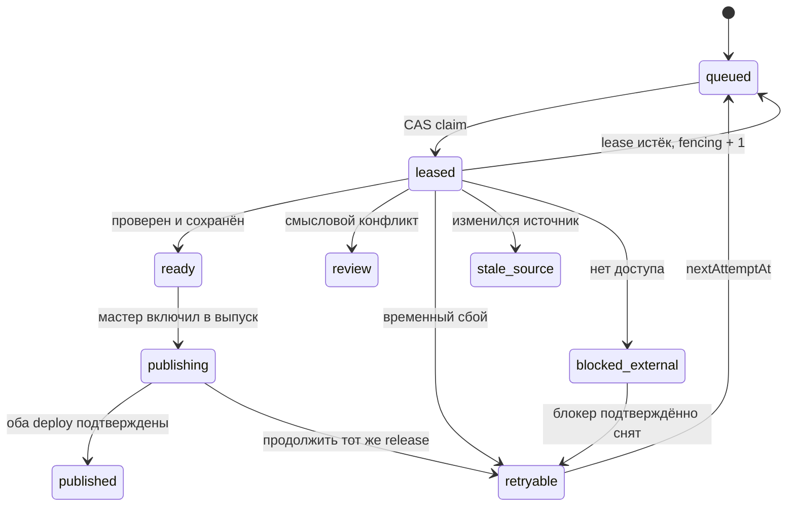

# Рой ADA: сопоставление и перевод RU → EN

Версия проекта регламента: 1.1, 29.10.2026. Сначала применять sections 1–3 docs/workflows/english-site.md.
Обязательная общая основа: `docs/workflows/agent-swarms.md`.
Статус: **инструкции подготовлены; production-диспетчер перевода и автозапуск
работников ещё не реализованы и массовый рой не запущен**.

## 1. Разделение ролей

| Роль | Разрешённая работа | Результат |
| --- | --- | --- |
| Координатор источников | Инвентарь, дедупликация, точное Tour ↔ Word соответствие, block map, утверждённые редакции, конфликты | Frozen manifest и пригодные source packets |
| Переводчик | Только назначенные текстовые сегменты; точное копирование Word и перевод непокрытого RU | Immutable result + provenance + QA/checkpoint |
| Редактор QA | Смысл, факты, модальность, голос Ada Tours, сохранение Word, полнота ссылок и блоков | Одобрение конкретного content hash либо review |
| Мастер публикации | Сверка свежего main и receipts, общий content assembly, два build/deploy, публикационный журнал | Подтверждённый release |

Координатор и мастер могут быть одним логическим процессом, но worker никогда
не получает права менять `main`, общую схему, меню, SEO-формулы, цены, изображения,
маршруты, другие очереди и свои own approval-gates. Самостоятельные Excursion
имеют единственного владельца переводимых блоков даже при использовании в десяти
турах. Копии одинаковых предложений из разных Word не создают десять задач.

## 2. Подготовка до первого переводчика

1. Зафиксировать свежий main SHA и source inventory version. Текущий baseline
   и первичная ведомость — в `data/i18n/programme-sources.json`,
   `tour-word-matches.json`, `word-pilot-review.json`.
2. Содержательно проверить match для каждого Tour. Имя/score лишь предлагает
   кандидатов; matching принимает решение по географии, длительности, порядку
   дней, ночёвкам, главным объектам, включениям и существенным условиям.
3. Для каждой пары закрепить один документ и редакцию, остальные кандидаты
   оставить с явным исходом. `same name`, `nameSimilarity`, 70% GEO-policy и
   нахождение в папке 2027 не являются подтверждением точного соответствия.
4. Полный DOCX извлечь один раз. Сохранить SHA-256 байтов, modifiedTime/revision,
   extraction version, XML refs, точный текст и hashes фрагментов. Readable fetch
   только помогает искать; он уже пропустил реальные таблицы в пилоте.
5. Составить стабильную sidecar-карту Tour/Excursion/общих сегментов. Каждый
   видимый блок получает `word_exact`, `ai_translation` либо техническое
   исключение; отличия с прежним русским текстом не требуют ручного review.
6. Неотражённые в документе части переводятся из актуального RU. При уверенном Tour ↔ Word сопоставлении EN содержание берётся из Word. Новые тарифы Word 2027 передаются мастеру отдельной структурированной поправкой общих цен RU/EN, без ручного review отличия со старым сайтом. Техническую неидентичность и нечитаемые строки фиксировать как адресные блокеры.
7. Внести glossary имён/мест/продуктов и обязательные `protectedTerms`,
   `protectedTokens`, коммерческие зависимости. Меню и короткие общие строки
   использовать из `src/data/i18n/ui-copy.json`, не поручать рою.
8. Прогнать подготовленный диспетчер на гонках/потерянных ответах/истечении
   lease и права записи в будущую staging-ветку. Пройти предметный пилот на
   3–5 задачах минимум двумя исполнителями. Только затем открыть массовый этап.

Подтверждение восьми идентичностей текущего пилота не закрывает пункт 5. Сейчас
полных block maps и допущенных к публикации переводов нет. Подготовленную ведомость
нельзя автоматически превратить в 358 разрешений на перезапись.

## 3. Очерёдность, которую назначает координатор

Сначала сопоставляются оба года, затем выдача использует сохранённое решение.
Переводчик сам не ищет папки и не выбирает следующий год.

| Этап | Кому выдавать | Переход |
| --- | --- | --- |
| `match_2027` | Активные туры без решения по 2027 | `selected_2027`, `not_found_2027` или `match_review` |
| `match_2026` | Только `not_found_2027` | `selected_2026`, `not_found_both` или `match_review` |
| `word_2027` | Подтверждённые пары 2027 и их общие зависимости | Точные Word-фрагменты + AI только для непокрытых фрагментов этого Tour |
| `word_2026` | Подтверждённые пары 2026, не покрытые 2027 | Английские тексты из Word 2026; более новые тарифы 2027 не откатывать |
| `ai_only` | Только доказанный `not_found_both`, включая проверку допустимых карантинных источников | Полный верный перевод RU |
| `other_content` | Страны, места, экскурсии, темы, обычные страницы | Перевод текущего принятого RU с общими правилами |
| `seo_geo` | Страницы и их ссылочные зависимости уже готовы | Перевод статьи с voice QA в том же проходе |

Сначала открывается волна `word_2027`, затем `word_2026`, затем `ai_only`.
Общие экскурсии/названия/страны, нужные как зависимости, могут готовиться
параллельно. Этап меняет координатор; `busy` в текущем этапе не разрешает
работнику самовольно брать нижний приоритет. Конкретный Tour с нерешённым 2027
matching нельзя отправить в 2026/AI. Изолированный review не должен навсегда
блокировать остальные уже доказанные продукты: его исключение из текущего
релиза фиксируется явно, не как успех.

Если Tour выбран по 2027, недостающий абзац не ищут в 2026 автоматически:
пользователь назначил 2026 для ещё не покрытых туров. Менять эту политику можно
только явным новым решением, записанным в manifest version.

## 4. Manifest и пакет

Будущая рабочая ветка: `i18n/translation-staging`; текущая feature-ветка хранит
проект/код/подготовку. Создание staging и наполнение dispatch state выполняются
после тестов диспетчера, а не скрыто при чтении этого документа.

Immutable manifest содержит `manifestVersion`, main/source SHA, allowed paths,
glossary revision, source/mapping/block-map hashes, task dependencies и exclusions.
У задачи: устойчивый `jobId`, `entityId`, target locale, stable `blockIds`,
`sourceFingerprint`, stage, expected output, expected target hashes, список
фактических зависимостей и закреплённый source packet.

Исходный рабочий лимит для пилота:

- До **8 смысловых сегментов** одного владельца за claim и до **12 000 слов**
  суммарного RU/EN источника; большой день делится по утверждённым сегментам.
- Один живой пакет на работника; lease **90 минут**, продление через **20 минут**.
- Checkpoint готовых частей после каждых 4 сегментов или перед долгой паузой.
- До **6 завершённых пакетов за чат**; после сохранения текущего автоматически
  брать следующий eligible пакет до лимита, без ожидания слова «дальше».
- Начать с **2 работников** на пилоте; масштаб 4–8 разрешать только после
  измерения API-бюджета и конфликтов. Это целевые параметры, не уже запущенные чаты.

Считаются исходные/целевые блоки и уникальные задачи, а не число попыток или
длину ответа в чате. Несколько сегментов одного абзаца можно сшить при рендере,
но provenance каждого `word_exact` и AI-фрагмента остаётся отдельным.

## 5. Диспетчер: обязательный контракт реализации

Рекомендуется повторно использовать проверенные подходы текущих GitHub-роев,
не запускать отдельную БД лишь ради первого перевода. Это отдельный namespace
и очередь; текущие SEO/GEO/фото claims не меняются.

Нужны компактные CAS-shards (например, 16), индекс доступных задач, индекс retry
и summary. Claim/status не перечитывают все 732 документа и все Tour MD.
Неизменяемые manifest/source packets загружаются один раз на соответствующий SHA.

### Обязательные операции

| Операция | Проверки и эффект |
| --- | --- |
| `claim` | stage/dependencies, source hash, CAS shard; ownerId/token/generation/expiry |
| `renew` | Тот же owner/token/generation, неистёкший lease, CAS |
| `checkpoint` | Свои пути, source fingerprint, устойчивый checkpoint ID; уже сохранённые части не теряются |
| `submit` | Постоянный submissionId + payload hash; тот же результат возвращает already_saved; проверка QA/provenance/coverage |
| `release` | Только собственный актуальный lease, без удаления ready частей |
| `reap` | Истёкшие leases fencing+1, eligible retry; известная история остаётся |
| `status` | Один компактный snapshot, никаких build/Drive scans |
| `resume` | Точный job/run/submission/checkpoint, проверка receipt до повтора |
| `publish` | Отдельный мастер; fresh main, точные hashes, один release, два receipts |

При multi-file submit Git tree/commit обновляется с expected branch SHA; конфликт
означает перечитать head и перенести **только свои** изменения, максимум два
адресных повтора. CAS отдельных shard файлов уменьшает чтения, но не отменяет
общий конфликт branch head при multi-file commit. При высокой конкуренции
сериализовать финальную фиксацию координатором, не добавлять force push.

Рабочий бюджет: ориентир 8–10 API-вызовов на сохранённый пакет плюс редкие
checkpoint/renew. Фактическую верхнюю границу считать с учётом всех активных
роев аккаунта. 403/429/Retry-After включают общий circuit breaker; без смены
аккаунта/токена и горячего повтора. Сборка не тратит Drive API.

Реализацию считать готовой только после воспроизводимых тестов 5–20 одновременных
claim, старого поколения, duplicate submit, потери ответа после commit,
partial ready+retry, changed source, отзыва доступа, rate limit и мастера рядом
с worker commit. Новые overlay unit tests проверяют другой слой; они не
заменяют испытания распределённого диспетчера.

## 6. Автомат состояний и восстановление

У блока только `draft/review/approved`; `published` принадлежит журналу выпуска.
`approvedContentHash` связывает QA с точным текстом, provenance и evidence.
Поменялся текст или source — прежний QA больше не подходит. Счётчик «обработано»
не подменяет счётчик готовых/опубликованных.

Reaper выполняется при claim и независимым контролируемым scheduler. Если все
чаты закрылись, нужен работающий runner либо явное уведомление координатору о
новых eligible задачах. Обычный GitHub Actions не получает возможности запускать
ChatGPT-чаты только из-за наличия cron. Пока runner/доступ модели не настроен,
обещать автоматическую работу переводчиков ночью нельзя.

Существующий Word daily процесс 2027 продолжает свою задачу; будущий EN watcher
должен переиспользовать его source revision events, а не дублировать импорт и
генерацию фото. Добавлять расписание переводов нужно после рабочего end-to-end
pilot; сейчас новая ChatGPT automation не создаётся.

## 7. Инструкция переводчику: текст для отдельного рабочего чата

> **Рой ADA: перевод EN.** Работай в `alexyakovlev79/adatours.ru` только по
> действующему `docs/plans/english-site/04-swarm-runbook.md` и открытой версии
> translation manifest. Сначала проверь статус диспетчера и gates. Если
> production dispatcher ещё не реализован или massLaunchAllowed=false, сохрани
> точный blocker; не редактируй JSON очереди вручную и не начинай произвольные
> туры. После законного claim выполняй только назначенные stable blocks и
> закреплённые источники. Сохраняй точные Word-фрагменты, допереводи только
> непокрытое, соблюдай `03-translation-editorial.md`. Не меняй общие факты,
> цены, media, маршруты, UI и шаблоны напрямую. Новые тарифы Word 2027 передавай мастеру структурированным результатом с точными source refs. Проверяй voice в первом проходе, сохраняй
> provenance/QA/content hashes и immutable receipt. После сохранения пакета
> бери следующий eligible пакет до лимита; при конфликте используй resume,
> не начинай заново и не присваивай published.

Это подготовленная команда будущего запуска. Она намеренно не изображает
несуществующий CLI `translate --all` и не разрешает обходить незавершённые gates.

## 8. Инструкция мастеру публикации

> **Рой ADA: собери EN-релиз.** Прочитай свежий main, translation manifest и
> publication ledger. Собери ровно один releaseId из ready результатов с
> актуальными source/Word/target hashes. Исключи stale/review/blocked, не
> переписывай чужие или независимо изменённые тексты. Проверь полный граф
> локализованных зависимостей и связи экскурсионных блоков. Сделай один
> логический content commit поверх актуального main. Собери RU/EN одним кодом,
> проверь факты, домены, ссылки и язык, затем опубликуй настроенные targets.
> Подтверди exact receipts обоих deployment; только после этого отметь
> published/synchronized. Если один target не прошёл, продолжи тот же release,
> сохрани частичный успех и точный blocker. Не меняй DNS и не заменяй legacy
> adatours.com, пока отдельно не выполнен план доменной миграции.

## 9. Что выдаёт status

Manifest/source SHA; время snapshot; уникальные jobs/blocks; queued/leased/expired/
ready/review/retryable/blocked_external/stale_source/failed_final/published;
число непокрытых сегментов; stage; owners/expiry без секретов; last checkpoint;
API usage/remaining и circuit breaker; текущий release и RU/EN deploy SHA.

В текущей подготовке status должен прямо показывать: matching не завершён,
8 identity-confirmed пар ждут block alignment, 0 полных EN-туров, 0 разрешений
AI-only, 0 EN publications. `exhausted` к этому состоянию неприменим.
